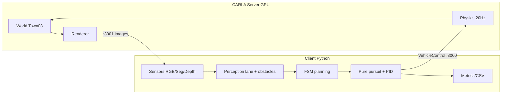
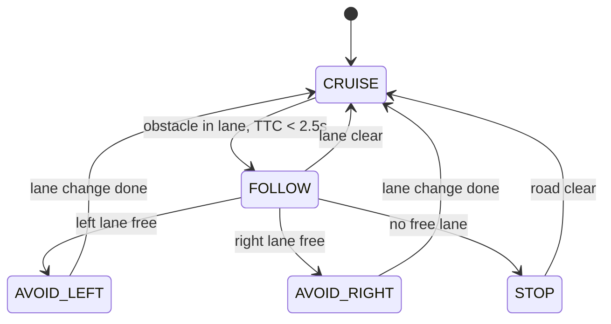

# Sơ đồ hệ thống — Lane Detection + Object Avoidance (CARLA)

Dự án: Autonomous Driving (Simulation)
Tools: CARLA 0.9.16, OpenCV, Python 3.11
Hạ tầng: CARLA server (GPU, 5GHz WiFi) ↔ client (Ubuntu) qua LAN/Tailscale

---

## 1. Sơ đồ triển khai (deployment)

```
╔════════════════════════════════ SERVER (GPU, 5GHz WiFi) ═════════════════════════════════╗
║  CARLA 0.9.16  (Unreal Engine 4)                                                         ║
║                                                                                          ║
║   ┌──────────────┐   ┌──────────────┐   ┌──────────────────┐   ┌────────────────────┐  ║
║   │ World / Map  │   │ Physics      │   │ Renderer (GPU)   │   │ Traffic + Peds     │  ║
║   │ Town03       │   │ 20 Hz sim    │   │ ~120 fps no-cam  │   │ autopilot (TM)     │  ║
║   └──────────────┘   └──────────────┘   └──────────────────┘   └────────────────────┘  ║
║                                                                                          ║
║   RPC      :3000  ── spawn xe, tick, apply_control, đọc trạng thái                       ║
║   Streaming:3001  ── ảnh sensor (TCP, raw BGRA)                                          ║
╚════════════════════════════════════════╤═════════════════════════════════════════════════╝
                                         │  5GHz / Tailscale 100.x
                                         │  RTT ~2 ms, throughput ~38 MB/s
╔════════════════════════════════════════╧═════════════════════════════════════════════════╗
║  CLIENT (Ubuntu, Python 3.11, carla 0.9.16, OpenCV)                                      ║
║                                                                                          ║
║    sensors.py  ──►  perception/  ──►  planning/  ──►  control/  ──► VehicleControl       ║
║    (camera,seg,     (lane, objects,    (FSM trạng     (pure pursuit                      ║
║     depth, ego)      distance)          thái)          + PID)                            ║
║         ▲                                                                     │          ║
║         └────────────────────  world.tick() 20 Hz  ◄──────────────────────────┘          ║
╚══════════════════════════════════════════════════════════════════════════════════════════╝
```

## 2. Một vòng lặp real-time (50 ms/tick)

```
 t=0 ms
 main.py: world.tick()
    │
    ▼
 SERVER: mô phỏng 0.05 s → render → capture sensor
    │     RGB 512×288 (0.59 MB) + seg/depth 192×108 (0.08 MB mỗi cái)
    ▼  ~5–15 ms qua 5GHz
 CALLBACK (thread riêng của CARLA) → queue(maxsize=1, bỏ frame cũ)
    │
    ▼
 PERCEPTION (~5–10 ms CPU)
    ├─ lane_detection : RGB + seg  → centerline, e_y, e_ψ, κ
    ├─ obstacles      : seg + depth → [distance, lateral, class]
    └─ ego            : speed, pose
    │
    ▼
 PLANNING (FSM, <1 ms)  →  state, target_speed, target_lane
    │
    ▼
 CONTROL (~1 ms)
    ├─ pure pursuit → steer
    └─ PID          → throttle / brake
    │
    ▼
 vehicle.apply_control(VehicleControl)  ──RPC :3000──►  SERVER áp vào xe
    │
 t=50 ms  →  world.tick() tiếp theo
```

## 3. Perception chi tiết

```
                ┌──────────────────── RGB 512×288 ────────────────────┐
                │                                                     │
                ▼                                                     ▼
        [Lane — OpenCV]                                    [Semantic seg 192×108]
 grayscale → blur → Canny                                  BGRA, tag nằm ở kênh R
        → ROI trapezoid                                    → CityScapes palette
        → sliding window                                   ├ Road(1) ─────┐
        → fit tuyến tính x = a·y + b                       ├ RoadLines(24)┤→ road/lane mask
        → centerline + lookahead                           └ Sidewalk(2) ─┘
        → centerline + lookahead                           ├ Vehicles(10) ─┐
                │                                          └ Pedestrians(4)┘
                │                                                     │
                ▼                                                     ▼
        e_y (lệch tâm), e_ψ (lệch hướng),                  bounding boxes
        κ (độ cong), confidence                            + depth → khoảng cách (median)
                │                                                     │
                └──────────────►  LaneState + [Obstacle]  ◄───────────┘
```

## 4. Planning — máy trạng thái (FSM)

```
            ┌──────────────────────────────────────────────────┐
            ▼                                                  │
       ┌─────────┐   vật cản trong làn, TTC < 2.5 s      ┌─────────┐
  ───► │ CRUISE  │ ────────────────────────────────────► │ FOLLOW  │
       │ 30 km/h │ ◄──────────────────────────────────── │ giữ khoảng│
       └────┬────┘        hết vật cản / làn thông        └────┬────┘
            │                                                 │
            │ làn kề trống (kiểm tra ROI seg)                 │ không thể theo
            ▼                                                 ▼
       ┌───────────────┐                             ┌──────────────┐
       │ AVOID_LEFT/   │ ──── chuyển làn xong ─────► │    STOP      │
       │ RIGHT         │                             │ brake = 1    │
       └───────────────┘                             └──────┬───────┘
                                                            │ thông thoáng
                                                            ▼
                                                         CRUISE
```

Điều kiện:
- `FOLLOW` khi có vật cản phía trước cùng làn, `TTC = khoảng_cách / v_ego < 2.5 s`.
- `AVOID_*` chỉ khi làn kề trống trong ROI 20–40 m (dùng seg để đếm pixel Vehicles/Pedestrians).
- `STOP` khi cả 2 làn kề đều bận.

## 5. Control

```
 LaneState(e_y, e_ψ, κ)  +  lookahead (x_l, y_l)
      │
      ▼
 pure pursuit:  δ = atan( 2·L·sin(α) / Ld )
      │         L = wheelbase, Ld ≈ 10–15 m
      ▼
 steer ∈ [-1, 1] ───────────────────────────────┐
                                                ▼
 target_speed (từ FSM) ──► Speed PID ──► throttle / brake ∈ [0, 1]
                                                │
                                                ▼
                                    carla.VehicleControl
```

## 6. Module ↔ trách nhiệm ↔ interface

```
 main.py  (vòng lặp 20 Hz, ghép tất cả)
   │
   ├── world/connect.py     carla.Client(host, 3000), sync mode, fixed_delta=0.05
   ├── world/sensors.py     SensorFrame(rgb, seg, depth, ego, collision)
   ├── world/vehicle.py     spawn ego, apply_control, hủy actor
   │
   ├── perception/lane_detection.py   detect(rgb, seg) -> LaneState
   ├── perception/segmentation.py     road/lane mask, palette, classes
   ├── perception/obstacles.py        detect(seg, depth) -> [Obstacle]
   │
   ├── planning/decision.py  update(lane, obstacles, ego) -> Command
   ├── control/pure_pursuit.py  steer(lane, speed)
   ├── control/pid.py           throttle/brake(speed_error)
   │
   └── metrics.py            CSV + đếm collision / lane_invasion
```

## 7. Hợp đồng dữ liệu (signal contract)

| Tín hiệu | Nguồn | Kích thước | Tần số | Dùng cho |
|---|---|---|---|---|
| RGB | camera.rgb | 512×288×4 B | 20 Hz | lane |
| Semantic seg | camera.semantic_segmentation | 192×108×4 B | 20 Hz | road + object |
| Depth | camera.depth | 192×108 float | 20 Hz | khoảng cách |
| Ego state | vehicle.get_* | ~10 số | 20 Hz | PID, TTC |
| LaneState | perception | 5 số | 20 Hz | steering |
| Obstacle[] | perception | 0–5 mục | 20 Hz | FSM |
| VehicleControl | control | 3 số | 20 Hz | actuator |

## 8. Ngân sách thời gian 1 tick

| Bước | Thời gian |
|---|---|
| server sim + render | 8–15 ms |
| truyền ảnh ~0.82 MB | 5–10 ms |
| perception | 5–10 ms |
| planning + control | 1–2 ms |
| **tổng** | **~20–35 ms < 50 ms** |

## 9. Sơ đồ tổng hợp (Mermaid)



**Cách đọc:** dữ liệu chảy trái → phải (cảm biến → nhận thức → quyết định → điều khiển), rồi **quay ngược** về server qua `apply_control`; `world.tick()` đồng bộ toàn bộ vòng lặp ở 20 Hz. Mọi phép đo/kiểm tra về sau đều gắn vào 1 trong 3 mốc: (a) sensor, (b) perception lane/obstacle, (c) control.

## Phụ lục — FSM dạng Mermaid



## Ghi chú quy ước

- CARLA dùng hệ tọa độ UE4 (left-handed): `x` tiến, `y` sang phải, `z` lên; đơn vị mét.
- Ảnh: `u` sang phải, `v` xuống; IPM biến đổi về hệ xe (`x` tiến, `y` trái).
- `steer ∈ [-1, 1]`: quy ước dấu kiểm tra lại khi code (dương = phải).
- Độ phân giải online: 512×288 (RGB) + 192×108 (seg/depth) để giữ 20 Hz trên WiFi;
  có thể tăng lên 640×360 nếu cắm Ethernet cho client/server.
- Đồng bộ: `synchronous_mode=True`, `fixed_delta_seconds=0.05`, `sensor_tick=0` (1 ảnh/tick).
